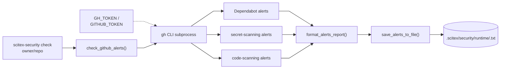
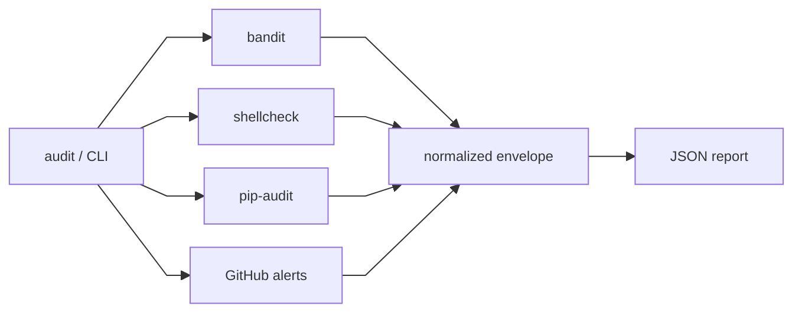

# scitex-security

<p align="center">
  <a href="https://scitex.ai">
    
  </a>
</p>

<p align="center"><b>Unified security scanning — bandit plus shellcheck plus pip-audit plus GitHub alerts in one orchestrator.</b></p>

<p align="center">
  <a href="https://scitex-security.readthedocs.io/">Full Documentation</a> · <code>uv pip install scitex-security[all]</code>
</p>

<!-- scitex-badges:start -->
<p align="center">
  <a href="https://pypi.org/project/scitex-security/"></a>
  <a href="https://pypi.org/project/scitex-security/"></a>
  <a href="https://scitex-security.readthedocs.io/en/latest/"></a>
</p>
<p align="center">
  <a href="https://github.com/ywatanabe1989/scitex-security/actions/workflows/pytest-matrix-on-ubuntu-py3-11-3-12-3-13.yml"></a>
  <a href="https://github.com/ywatanabe1989/scitex-security/actions/workflows/import-smoke-on-ubuntu-py3-12.yml"></a>
  <a href="https://codecov.io/gh/ywatanabe1989/scitex-security/branch/develop/graph/badge.svg"></a>
</p>
<!-- scitex-badges:end -->

---

## Problem and Solution

| # | Problem | Solution |
|---|---------|----------|
| 1 | **Scattered scanners** — bandit, shellcheck, pip-audit, and GitHub alerts each need separate setup | **`audit()`** — one orchestrator returning a unified `{status, findings, summary}` dict per check |
| 2 | **Alert sprawl** — Dependabot, secret-scanning, and code-scanning alerts live behind different `gh` calls | `check_github_alerts()` — **one call** collecting all three alert categories |

## Quick Start

```python
from scitex_security import audit

results = audit(".", checks=["python", "shell"])
print(results["python"]["summary"])
```

```bash
scitex-security check --path . --checks python,shell
```

## Demo



<p align="center"><sub><b>Figure 1.</b> GitHub alert collection from CLI call to saved report.</sub></p>

## Installation

```bash
uv pip install "scitex-security[all]"
```

Requires Python >= 3.10 plus the `gh` CLI for GitHub-alert checks.

<details>
<summary><b>Per-module extras</b></summary>

<br>

| Extra | Pulls in |
|---|---|
| `dev` | pytest, ruff, scitex-dev audit toolchain |
| `docs` | Sphinx plus theme and myst-parser |
| `all` | dev plus docs (recommended) |

```bash
uv pip install -e ".[dev]"  # editable install
```

</details>

## Architecture

### 1. Multi-tool sweep

`audit()` fans out over bandit, shellcheck, pip-audit, and the GitHub checker, normalizing each into `{status, findings, summary}`.

### 2. GitHub alerts

`check_github_alerts()` shells out to `gh` and never touches tokens directly — `GH_TOKEN` / `GITHUB_TOKEN` are read by the `gh` subprocess from the environment, not from this package.



<p align="center"><sub><b>Figure 2.</b> Orchestrator fan-out from one call to normalized results.</sub></p>

## 2 Interfaces

<details open>
<summary><strong>Python API (primary)</strong></summary>

<br>

```python
from scitex_security import (
    audit,
    check_github_alerts,
    save_alerts_to_file,
    format_alerts_report,
    GitHubSecurityError,
)

results = audit(".", checks=["python", "shell", "deps", "github"])

alerts = check_github_alerts(repo="ywatanabe1989/myrepo")
print(format_alerts_report(alerts))
save_alerts_to_file(alerts, output_dir=".scitex/security/runtime")
```

</details>

<details>
<summary><strong>CLI</strong></summary>

<br>

```bash
scitex-security check --path .
scitex-security check ywatanabe1989/myrepo
scitex-security show-latest --security-dir ~/.scitex/security/runtime
```

</details>

## Environment Variables

<p align="center"><sub><b>Table 1.</b> Configuration knobs read by scitex-security.</sub></p>

| Variable | Purpose | Default |
|----------|---------|---------|
| `SCITEX_SECURITY_CONFIG` | Path to a YAML config file | unset |
| `SCITEX_SECURITY_DIR` | Override the alerts output directory | project or user scope |
| `SCITEX_DIR` | Relocate the user-scope root | `~/.scitex` |
| `GH_TOKEN` / `GITHUB_TOKEN` | Auth token for the `gh` subprocess | unset |

Config precedence: explicit path → `$SCITEX_SECURITY_CONFIG` → `~/.scitex/security/config.yaml` → built-in defaults.
Alert output precedence: `--output-dir` / `--security-dir` → `$SCITEX_SECURITY_DIR` → project scope → user scope (respects `$SCITEX_DIR`).

## Status

Unified package owning the multi-tool security-audit orchestrator (bandit / shellcheck / pip-audit) plus the GitHub-alerts checker (Dependabot, secret scanning, code scanning). The audit orchestrator was absorbed from `scitex-audit 0.2.0` per ADR-0002.

## Part of SciTeX

`scitex-security` is part of [**SciTeX**](https://scitex.ai). Install via
the umbrella with `pip install scitex[security]` to use as
`scitex.security` (Python) or `scitex security ...` (CLI).

>Four Freedoms for Research
>
>0. The freedom to **run** your research anywhere — your machine, your terms.
>1. The freedom to **study** how every step works — from raw data to final manuscript.
>2. The freedom to **redistribute** your workflows, not just your papers.
>3. The freedom to **modify** any module and share improvements with the community.
>
>AGPL-3.0 — because we believe research infrastructure deserves the same freedoms as the software it runs on.

## License

AGPL-3.0-only (see [LICENSE](./LICENSE)).

---

<p align="center">
  <a href="https://scitex.ai" target="_blank"></a>
</p>
